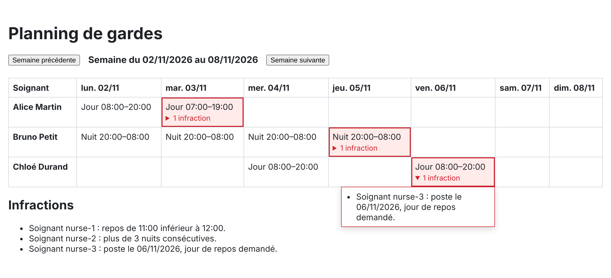

# Planning de gardes : vérificateur de règles

[](https://gitlab.com/steveboulay/planning-gardes/-/pipelines)

On lui donne le planning d'un service de soins, il renvoie les règles enfreintes : repos insuffisant, trop de nuits d'affilée, trop d'heures dans la semaine, jour de repos demandé non respecté. Il ne construit pas de planning, il contrôle celui qu'on lui soumet.

Projet personnel, écrit pour apprendre Python, puis Django et React, en venant de PHP et Symfony. Le code suit la méthode « test d'abord », avec pytest pour le backend et Vitest pour le front (les écarts sont notés dans le journal), et la CI GitLab le vérifie à chaque push.

## Les règles

Le moteur est en Python pur, sans dépendance à Django, dans `backend/planning_rules/`. Chaque règle est une fonction qui reçoit des postes et renvoie une liste d'infractions. Les seuils sont des paramètres.

| Fonction | Code | Catégorie | Règle |
|---|---|---|---|
| `check_daily_rest(shifts, min_rest)` | `repos_quotidien` | légale | Entre deux postes d'un même soignant, le repos dure au moins `min_rest`. Infraction datée du jour du second poste. |
| `check_consecutive_nights(shifts, max_nights)` | `nuits_consecutives` | collective | Pas plus de `max_nights` nuits sur des jours qui se suivent. Une infraction pour chaque nuit au-delà de la limite. |
| `check_weekly_hours(shifts, max_duration)` | `heures_hebdomadaires` | légale | Pas plus de `max_duration` par semaine, du lundi au dimanche. Un poste compte dans la semaine où il commence. Infraction datée du lundi. |
| `check_day_off_requests(shifts, requests)` | `desiderata` | individuelle | Une infraction pour chaque demande de repos qui tombe un jour où le soignant a un poste qui commence. |

`check_schedule(shifts, requests, config)` lance les quatre règles et renvoie toutes les infractions, triées par jour, puis par soignant, puis par code de règle.

Les seuils par défaut sont regroupés dans `DEFAULT_CONFIG` (`RulesConfig`) :

- **repos quotidien : 12 heures**, le minimum de la fonction publique hospitalière (décret n° 2002-9 du 4 janvier 2002). Il peut être abaissé à 11 heures : c'est le minimum des salariés de droit privé (Code du travail, article L3131-1), et celui que la fonction publique hospitalière autorise après un accord avec les organisations syndicales (décret n° 2021-1544 du 30 novembre 2021) ;
- **nuits consécutives : 3**, une règle de service et non une règle légale ;
- **durée hebdomadaire : 48 heures** (directive européenne 2003/88/CE).

## Exemple

Depuis le dossier `backend/`, avec `uv run python` :

```python
from datetime import datetime

from planning_rules.models import Shift, ShiftKind
from planning_rules.rules import check_schedule

shifts = [
    Shift(
        staff_id="nurse-1",
        start=datetime(2026, 11, 2, 8, 0),
        end=datetime(2026, 11, 2, 20, 0),
        kind=ShiftKind.DAY,
    ),
    Shift(
        staff_id="nurse-1",
        start=datetime(2026, 11, 3, 7, 0),
        end=datetime(2026, 11, 3, 19, 0),
        kind=ShiftKind.DAY,
    ),
]

for violation in check_schedule(shifts):
    print(violation.day, violation.category.value, violation.message)
```

```
2026-11-03 légale Soignant nurse-1 : repos de 11:00 inférieur à 12:00.
```

## Base de données

Les soignants, les postes et les demandes de repos sont stockés dans PostgreSQL 18, lancé avec Docker Compose. Depuis la racine du dépôt :

```bash
docker compose up -d
cd backend
uv run python manage.py migrate
uv run python manage.py loaddata demo
uv run python manage.py createsuperuser
uv run python manage.py runserver
```

`loaddata demo` charge une semaine de démonstration, du 2 au 8 novembre 2026, avec une infraction de chaque catégorie. L'admin de Django, à l'adresse http://127.0.0.1:8000/admin/, permet de consulter et de saisir les données.

La base refuse trois sortes de données incohérentes, par des contraintes PostgreSQL : un poste qui finit avant de commencer, une demande de repos enregistrée deux fois, et deux postes d'un même soignant qui se chevauchent. Cette dernière est une contrainte d'exclusion, propre à PostgreSQL, qui s'appuie sur l'extension `btree_gist`.

## L'API

Une API Django REST Framework expose le moteur de deux façons : un endpoint sans état, qui vérifie le planning envoyé en JSON, et des endpoints de lecture, qui vérifient le planning enregistré en base. Le code est réparti en quatre dossiers de `backend/` : `planning_rules/` pour le moteur, `schedules/` pour les modèles et l'admin, `api/` pour les serializers et les vues, `config/` pour les réglages de Django.

### Vérifier un planning envoyé

```bash
curl -X POST http://127.0.0.1:8000/api/schedule/check/ \
  -H "Content-Type: application/json" \
  -d '{
    "shifts": [
      {"staff_id": "nurse-1", "start": "2026-11-02T08:00:00", "end": "2026-11-02T20:00:00", "kind": "jour"},
      {"staff_id": "nurse-1", "start": "2026-11-03T07:00:00", "end": "2026-11-03T19:00:00", "kind": "jour"}
    ],
    "day_off_requests": [{"staff_id": "nurse-1", "day": "2026-11-03"}],
    "config": {"min_daily_rest": "12:00:00"}
  }'
```

```json
{
  "violations": [
    {
      "rule": "desiderata",
      "category": "individuelle",
      "staff_id": "nurse-1",
      "day": "2026-11-03",
      "message": "Soignant nurse-1 : poste le 03/11/2026, jour de repos demandé."
    },
    {
      "rule": "repos_quotidien",
      "category": "légale",
      "staff_id": "nurse-1",
      "day": "2026-11-03",
      "message": "Soignant nurse-1 : repos de 11:00 inférieur à 12:00."
    }
  ]
}
```

Format de la requête :

- `shifts` est obligatoire, éventuellement vide ; `day_off_requests` et `config` sont facultatifs.
- Les dates et heures sont au format `AAAA-MM-JJTHH:MM:SS`, sans fuseau horaire (`2026-11-02T08:00:00`) : une heure suivie d'un décalage (`+01:00`) ou de `Z` est refusée, comme une heure sans secondes. Les jours sont au format `2026-11-03`.
- `kind` vaut `"jour"` ou `"nuit"`.
- Dans `config`, `min_daily_rest` et `max_weekly_duration` sont des durées positives ou nulles au format `HH:MM:SS` (`"48:00:00"` est accepté), et `max_consecutive_nights` un entier au moins égal à 1. Un seuil absent garde sa valeur par défaut.

Erreurs : un code 400 avec le détail des champs en faute, par exemple `{"shifts": {"0": {"non_field_errors": ["Un poste doit se terminer après son début."]}}}` pour un poste qui finit avant de commencer, et un code 405 pour toute autre méthode que POST.

### Lire le planning enregistré

- `GET /api/staff/` : les soignants, triés par code.
- `GET /api/shifts/?start=2026-11-02&end=2026-11-08` : les postes qui commencent dans la période, bornes incluses, triés par début.
- `GET /api/schedule/violations/?start=2026-11-02&end=2026-11-08` : les infractions du planning enregistré pour la période, avec les seuils par défaut.

`start` et `end` sont obligatoires. Une période d'un seul jour est acceptée, une période qui finit avant de commencer est refusée (code 400).

Avec les données de démonstration :

```bash
curl "http://127.0.0.1:8000/api/schedule/violations/?start=2026-11-02&end=2026-11-08"
```

```json
{
  "violations": [
    {
      "rule": "repos_quotidien",
      "category": "légale",
      "staff_id": "nurse-1",
      "day": "2026-11-03",
      "message": "Soignant nurse-1 : repos de 11:00 inférieur à 12:00."
    },
    {
      "rule": "nuits_consecutives",
      "category": "collective",
      "staff_id": "nurse-2",
      "day": "2026-11-05",
      "message": "Soignant nurse-2 : plus de 3 nuits consécutives."
    },
    {
      "rule": "desiderata",
      "category": "individuelle",
      "staff_id": "nurse-3",
      "day": "2026-11-06",
      "message": "Soignant nurse-3 : poste le 06/11/2026, jour de repos demandé."
    }
  ]
}
```

## Le front



Une page React et TypeScript, dans `frontend/`, affiche une semaine : une ligne par soignant, une colonne par jour, et chaque poste dans la cellule du jour où il commence. Une cellule en infraction est encadrée de rouge, et un clic sur « 1 infraction » déplie les messages. La liste de toutes les infractions de la semaine suit la grille. Deux boutons passent à la semaine précédente ou suivante.

Django doit tourner sur le port 8000 (voir « Base de données »). Dans un second terminal :

```bash
cd frontend
npm ci
npm run dev
```

La page est à l'adresse http://localhost:5173/?date=2026-11-02. Le paramètre `date` choisit la semaine affichée ; sans lui, c'est la semaine du jour. En développement, Vite transmet les appels à `/api` au serveur Django.

Le code est réparti en cinq fichiers de `frontend/src/` :

- `week.ts` : le calcul des dates, sans React (lundi de la semaine, sept jours, ajout de semaines, mise en forme) ;
- `api.ts` : les types des réponses de l'API, et le chargement d'une semaine par trois appels lancés ensemble ;
- `WeekGrid.tsx` : la grille ;
- `ViolationList.tsx` : la liste des infractions ;
- `App.tsx` : la page, avec la navigation, le chargement et l'affichage d'une erreur.

Les tests, écrits avec Vitest et Testing Library, cherchent les éléments comme le ferait un lecteur d'écran : par leur rôle et leur texte. Les appels à l'API y sont simulés en remplaçant `fetch`.

## Lancer les tests

### Backend

Il faut [uv](https://docs.astral.sh/uv/), qui installe Python 3.13 si besoin.

```bash
docker compose up -d
cd backend
uv sync
uv run pytest
uv run ruff check .
uv run ruff format --check .
uv run python manage.py check
uv run python manage.py makemigrations --check --dry-run
```

### Front

Il faut Node 24.15 ou plus récent (voir `frontend/.nvmrc`).

```bash
cd frontend
npm ci
npm run check
```

`npm run check` enchaîne oxlint, Prettier, les tests Vitest, puis le build, qui vérifie aussi les types.

La CI GitLab lance les mêmes contrôles à chaque push, dans deux jobs : `backend` et `frontend`.

## Choix et limites

- Les dates n'ont pas de fuseau horaire. Une nuit qui traverse un changement d'heure dure en réalité 11 ou 13 heures.
- La durée hebdomadaire est comptée par semaine civile, du lundi au dimanche, alors que la réglementation raisonne sur toute période de sept jours.
- Deux postes d'un même soignant qui se chevauchent sont refusés par la base. Envoyés à `POST /api/schedule/check/`, qui ne stocke rien, ils apparaissent toujours comme un repos négatif.
- Une demande de repos ne peut pas être enregistrée deux fois. Envoyée deux fois à `POST /api/schedule/check/`, elle donne toujours deux infractions.
- Une nuit qui commence la veille d'un jour de repos demandé et se termine ce jour-là n'est pas une infraction : la règle porte sur le jour où le poste commence.
- L'API n'a pas d'authentification : c'est une API de démonstration. Aucun endpoint n'écrit en base, les données se saisissent dans l'admin ou se chargent par fixture.
- Les infractions d'une période ne voient que les postes de cette période : un repos trop court entre le dimanche soir et le lundi matin de la semaine suivante, ou une série de nuits commencée la semaine précédente, n'est pas signalé.
- Les identifiants de `compose.yaml` sont des valeurs de développement pour une base locale, pas des secrets.
- Le front fait confiance à la forme des réponses de l'API : les types TypeScript décrivent le JSON attendu, mais rien ne le vérifie à l'exécution.
- Les messages d'une cellule se déplient avec un élément HTML `<details>`. Ils se referment par un second clic, mais pas par un clic ailleurs ni par la touche Échap. La Popover API du navigateur le permettrait, mais jsdom, dans lequel tournent les tests, ne la gère pas.
- La mise en page n'est couverte par aucun test, puisque jsdom ne calcule pas de rendu. Elle a été vérifiée à la main dans un navigateur.

## Usage de l'IA

Le projet est développé avec l'aide de Claude (Anthropic) : découpage des étapes, explications, revue de code. Le journal [NOTES-IA.md](NOTES-IA.md) note, étape par étape, ce que l'IA a proposé, ce que j'ai gardé ou corrigé, et comment je l'ai vérifié.

## Suite

1. Des scénarios de bout en bout avec Playwright, dans un vrai navigateur, qui couvriront aussi la mise en page.
2. Une fenêtre pour les messages d'une cellule avec la Popover API, testée par ces scénarios.

## Licence

MIT. Voir [LICENSE](LICENSE).
